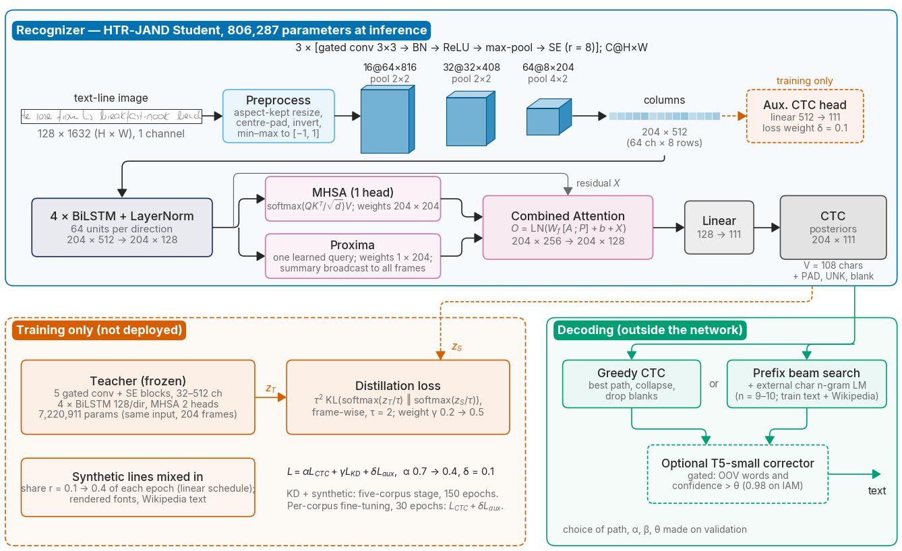
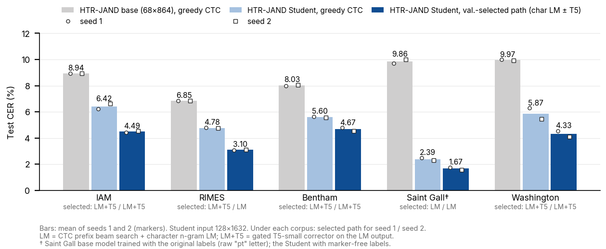
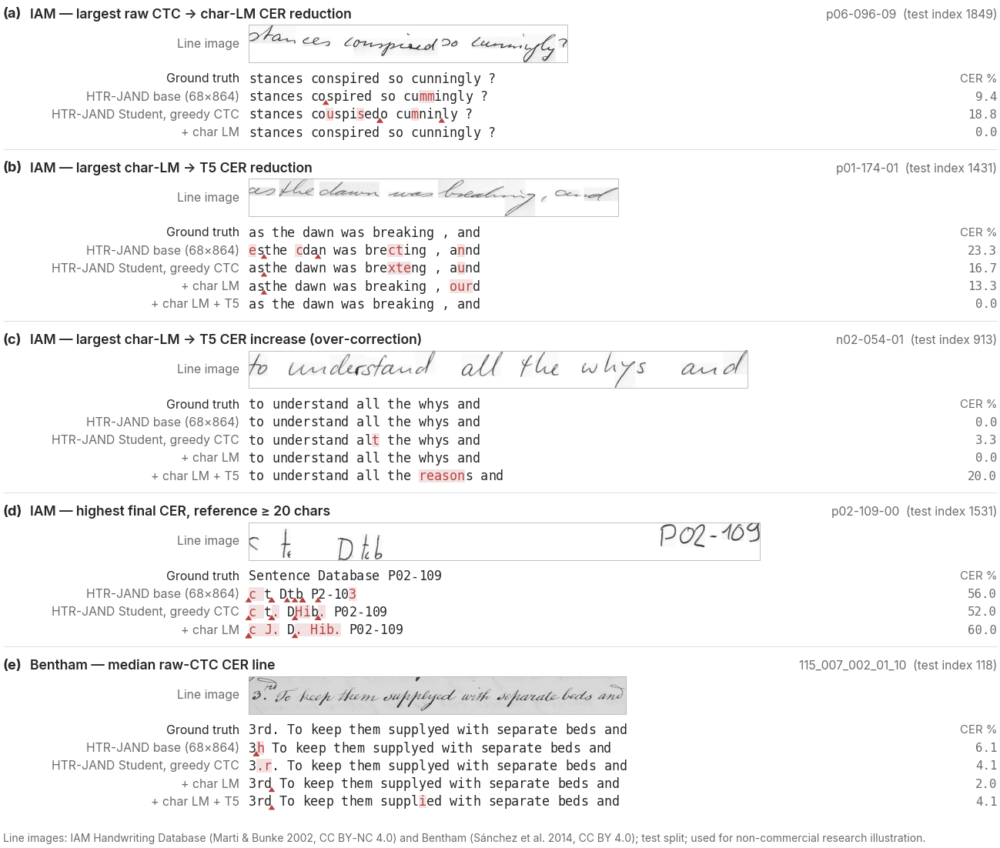
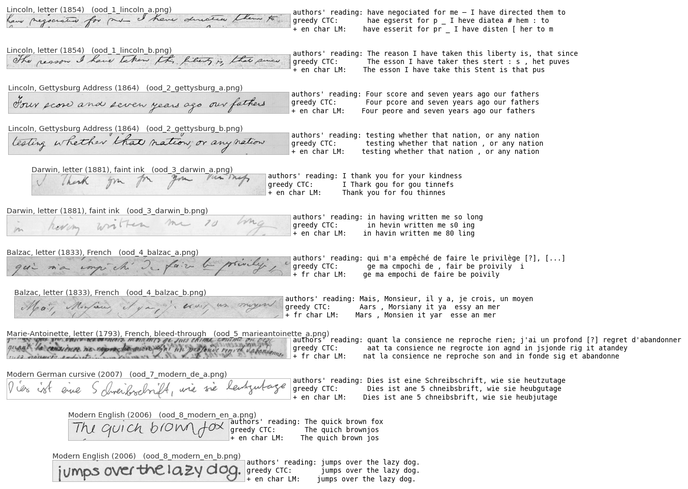
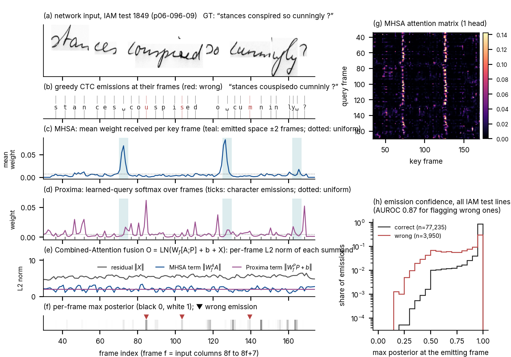

# HTR-JAND

**Handwritten Text Recognition with Joint Attention Network and Knowledge Distillation**: a compact,
line-level handwriting recognizer with gated convolutions, a combined self-attention / Proxima attention stage,
CTC, and Teacher–Student distillation, evaluated on IAM, RIMES, Bentham, Washington and Saint Gall under a
validation-only protocol.

M. Hamdan, A. Rahiche, M. Cheriet (ÉTS Montréal). Manuscript under review.

[](https://colab.research.google.com/github/DocumentRecognitionModels/htrjand/blob/main/notebooks/HTR_JAND_Demo.ipynb)
[](https://huggingface.co/MHamdan/htrjand-student)
[](https://huggingface.co/spaces/MHamdan/htrjand-demo)

## Try HTR-JAND

| | |
|---|---|
| Interactive demo | [Hugging Face Space](https://huggingface.co/spaces/MHamdan/htrjand-demo): drop a handwritten **line** image |
| Notebook | [Open in Colab](https://colab.research.google.com/github/DocumentRecognitionModels/htrjand/blob/main/notebooks/HTR_JAND_Demo.ipynb): install, download the model, transcribe your own line |
| Recommended model | [`MHamdan/htrjand-student`](https://huggingface.co/MHamdan/htrjand-student), variant `general` (five-corpus Student, seed 1) |
| One line, locally | `pip install git+https://github.com/DocumentRecognitionModels/htrjand.git && python predict.py --image examples/ood_2_gettysburg_b.png` |

HTR-JAND reads **one text line per image**. It does not do page layout analysis: page images are refused unless
you pass `--force` or use the naive, unevaluated `--segment-lines` helper.

## Overview

- **Architecture**: gated convolutions with squeeze-and-excitation (SE), four BiLSTM layers, a Combined Attention
  stage fusing multi-head self-attention (MHSA) with Proxima attention, and a CTC output layer.
- **Compact Student**: 806,287 parameters at inference, 128×1632 input, 1.18 GMAC per line, distilled from a
  7.2M-parameter Teacher where validation prefers it.
- **Training**: joint five-corpus training with synthetic handwriting-font lines, then per-corpus fine-tuning.
- **Decoding**: greedy CTC, CTC prefix beam search with a character n-gram language model, and an optional
  gated T5-small corrector.
- **Protocol**: model, decoder, corrector and correction gate are all chosen on validation data; test scores are
  archived for every candidate but never enter a choice. An experiment registry, a leakage audit and a split-overlap
  audit ship with the code.

## Base configuration vs. final HTR-JAND

| | Base configuration | Final HTR-JAND |
|---|---|---|
| Input | 68×864 | 128×1632 (aspect-preserving resize, centre pad) |
| Student | 3 gated-conv + SE blocks, 4 BiLSTM, 1 attention head | same components; 806,287 deployed parameters |
| Teacher | 5 gated-conv + SE blocks, 4 BiLSTM, 2 heads | same components, 7,220,911 deployed parameters |
| Recipe | early stopping on validation loss | AdamW, cosine schedule, EMA, strong augmentation, KD τ = 2 where validation prefers it |
| Data | per corpus | five corpora jointly + synthetic lines, then per-corpus fine-tuning |
| Decoding | greedy CTC | greedy, character LM beam search, gated T5 |
| Saint Gall training labels | as distributed | punctuation letter `pt` removed from **training** labels only |
| Seeds | 3 (IAM), 2 (five-corpus Student) | 2 Student seeds |

## Architecture



Training-only parts (Teacher, distillation loss, synthetic lines, auxiliary CTC head) are drawn apart from the
deployed recognizer. The language model and the T5 corrector are decoding stages outside the network.

## Results

Character error rate (CER, %) on the official test splits (IAM: FKI train / validation sets 1+2 / test; RIMES
ICDAR 2011; Bentham ICFHR 2014; Washington and Saint Gall from IAM-HistDB), mean of two Student seeds
(descriptive, n = 2). Every choice was made on validation data.

| Student | IAM | RIMES | Bentham | Saint Gall† | Washington |
|---|---:|---:|---:|---:|---:|
| Base configuration, five-corpus, 68×864, greedy CTC | 8.94 | 6.85 | 8.03 | 9.86 | 9.97 |
| HTR-JAND Student, greedy CTC | 6.42 | 4.78 | 5.60 | 2.39 | 5.87 |
| + character LM | 4.52 | 3.12 | 4.70 | 1.67 | 4.33 |
| Validation-selected path (LM ± gated T5) | **4.49** | **3.10** | **4.67** | **1.67** | **4.33** |

† The base configuration used the Saint Gall training labels as distributed; HTR-JAND uses the normalised training
labels (evaluation labels identical), so this column is not like-for-like.



**Teacher ensemble** (sequence-level ensemble of up to 12 Teachers + character LM): IAM 2.88, RIMES 2.16,
Bentham 3.85, Saint Gall 1.11, Washington 2.22.

**Where the LM gain comes from.** A character LM fitted on the training transcriptions alone gives two-thirds or
more of the LM gain; adding Wikipedia text lowers CER by a further 0.1–0.6 pp (nothing on Bentham).
`docs/audit_2026_10/CONTROLS.md`.

**T5 post-correction.** T5-small (60.5M parameters) with neighbouring-line context and a confidence gate, trained
only on out-of-fold recognitions of the training split and corrupted external text; gate parameters chosen on
validation. Mean relative CER change over five corpora: −3.6 % on greedy output (second seed −3.1 %), −0.8 % /
0.0 % after LM decoding. Without the gate it increases CER on every corpus. The same pattern holds when the
corrector is applied to the 68×864 base models and to a plain CNN-BiLSTM.

**Saint Gall training labels.** The ground truth marks punctuation dots with a special letter `pt` on the training
pages only (716 tokens; none on validation or test), so models learn to emit a token that no evaluation reference
contains. Removing it from the training labels (validation and test labels byte-identical) lowers the Teacher
ensemble + LM from 6.46 to 1.11 % test CER; deleting the emitted `pt` from the old models' output already gives
1.12 %, so the drop reflects the annotation convention, not a better model. `docs/audit_2026_10/SAINTGALL_AUDIT.md`.

**Adaptive curriculum (Algorithm 3).** Five stages with T0 = 0.70 and ΔT = 0.05; it did not lower validation CER
on any corpus and is disabled in the final configuration.

## Qualitative examples

Test lines selected by fixed rules (`scripts/build_qualitative_examples.py`), including an LM correction, a T5
correction, a T5 over-correction ("whys" → "reasons") and a failure:



## Real-world recognition examples

All twelve demo lines in `examples/` (public-domain or CC0 handwriting, **not** from any benchmark), decoded with
the general Student, greedy and with the released Wikipedia character LM. These are qualitative demonstrations:
the readings are ours and no error rate is reported. Clean modern and 19th-century English hands are read well;
faint ink, 18th-century French and bleed-through fail.



Regenerate with `python scripts/build_ood_figure.py`; sources and licences in `examples/SOURCES.md`.

## Interpretability



From real activations of the IAM Student on a test line: CTC alignment, MHSA weights, Proxima weights and the size
of each branch in the fusion. Over the IAM test set, MHSA is nearly query-independent with stripes on predicted
word gaps, and Proxima acts as a soft global pooling broadcast to every frame. Read
`docs/figures/attention_notes.md` before interpreting the maps.

## Installation

```bash
pip install git+https://github.com/DocumentRecognitionModels/htrjand.git     # inference
# full pipeline (training, decoding, T5, audits):
git clone https://github.com/DocumentRecognitionModels/htrjand.git && cd htrjand
pip install -e ".[dev]"            # + requirements-demo.txt for the Gradio app and T5
python -m pytest -q                # archive-dependent tests skip without the datasets
```

## Inference

```bash
python predict.py --image examples/ood_2_gettysburg_b.png                     # general Student, greedy CTC
python predict.py --variant iam --image line.png --decoder lm --t5            # IAM Student + LM + gated T5
python predict.py --model MHamdan/htrjand-teacher --image line.png            # single Teacher
python predict.py --model path/to/local/htrjand-student --variant rimes --image a.png b.jpg --json
```

```python
from htrjand import HTRJANDModel
model = HTRJANDModel.from_pretrained("MHamdan/htrjand-student", variant="general")
r = model.transcribe("line.png", decoder="lm", corpus="iam")
print(r.text, r.confidence)
```

Gradio app: `pip install -r requirements-demo.txt && python app.py`.

## Data preparation

The benchmark corpora are licensed and are **not** distributed here. Obtain IAM, RIMES, Bentham, Washington and
Saint Gall from their providers (`docs/audit_2026_10/LICENSING.md`), place the raw files under `raw/`, then:

```bash
export HTRJAND_DATA_DIR=/path/to/archives
python -m htrjand.prepare_data --help
scripts/build_c128.sh                          # 128×1632 archives, combined archive, synthetic lines
python scripts/build_saintgall_nopt.py         # Saint Gall training labels without the `pt` letter
```

## Training, distillation and evaluation

Every run is one line of a queue file in `configs/queues/` (exact command, seed, archive):

```bash
python scripts/run_queue.py configs/queues/runs_queue_P5.txt logs/P5    # 128×1632 Teacher, seed 1
python scripts/run_queue.py configs/queues/runs_queue_S2.txt logs/S2    # Student with KD from that Teacher
python scripts/run_queue.py configs/queues/runs_queue_FT.txt logs/FT    # per-corpus Student fine-tuning
python -m htrjand.evaluate --help
```

## Language model and T5 post-processing

```bash
python scripts/build_corpus_lm.py --help        # character LM from training transcriptions + Wikipedia text
python -m htrjand.ensemble_rescore --help       # CTC prefix beam search + char LM, single model or ensemble
scripts/t5_pipeline.sh                          # out-of-fold pairs -> T5 training -> validation-gated apply
```

The released LM (`MHamdan/htrjand-charlm`) is built from Wikipedia text only, because an n-gram LM fitted on the
benchmark transcriptions would redistribute them; it is weaker than the corpus LM used in the paper
(`docs/RELEASE_LM_EVAL.md`).

## Reproducing the results

```bash
python scripts/final_table.py           # validation-selected table -> docs/FINAL_RESULTS_T5.md, results/final_selection.json
python scripts/seed2_student_chain.py   # seed-2 Student protocol    -> results/seed2_student.json
```

These scripts read per-line prediction files, which contain ground-truth transcriptions and are therefore not in
this repository; regenerate them with `htrjand.evaluate` / `htrjand.ensemble_rescore` after building the archives.
The base configuration is `configs/htrjand_base.yaml`.

## Experiment registry

`scripts/registry.py` writes `docs/EXPERIMENT_REGISTRY.md`: one row per training run, decoding path and T5 path,
with archive, initialisation, selection rule and validation/test metrics. Released models record their registry id,
source commit and the SHA-256 of their weights in `config.json`.

## Leakage audit

`scripts/leakage_audit.py` checks that no T5 training target equals a test line unless the benchmark itself repeats
it in its training split, that external text contains no verbatim test line, that every gate equals its validation
optimum, and that fold models decoded disjoint halves (verdict: PASS). `scripts/overlap_audit.py` checks the
official splits for shared images by sample ID, pixel hash and near-duplicate matching: **none**. The only
cross-split matches are repeated strings such as RIMES salutations (`docs/DATA_SPLITS.md`).

## Repository structure

```
htrjand/     package: models, data, training, decoding, T5 post-processing, release API
predict.py   command-line inference          app.py     Gradio demo
configs/     base configuration and the exact queue of every run
scripts/     archive builders, queues, tables, registry, audits, figures, controls, HF export
results/     metrics JSON of every run (no per-line predictions)
docs/        reports, audits, figures, registry
examples/    out-of-distribution demo lines with sources and licences
notebooks/   Colab demo
tests/       unit tests (archive tests skip without data)
```

## Pretrained models

| Repository | Content | Licence |
|---|---|---|
| [`MHamdan/htrjand-student`](https://huggingface.co/MHamdan/htrjand-student) | Student seed 1: `general` (five-corpus) + `iam`, `rimes`, `bentham`, `saintgall`, `washington` | CC BY-NC 4.0 |
| [`MHamdan/htrjand-student-seed2`](https://huggingface.co/MHamdan/htrjand-student-seed2) | Student seed 2, same variants | CC BY-NC 4.0 |
| [`MHamdan/htrjand-teacher`](https://huggingface.co/MHamdan/htrjand-teacher) | one general 128×1632 Teacher | CC BY-NC 4.0 |
| [`MHamdan/htrjand-t5-corrector`](https://huggingface.co/MHamdan/htrjand-t5-corrector) | T5-small corrector | CC BY-NC 4.0 (base model Apache-2.0) |
| [`MHamdan/htrjand-charlm`](https://huggingface.co/MHamdan/htrjand-charlm) | Wikipedia character LMs (en, fr, la) and lexicons | CC BY-SA 4.0 |

The per-corpus variants are the validation-selected Students of the results table; `general` is their five-corpus
parent and the default for unseen handwriting.

## Practical use

Research on line-level HTR, benchmarking, and a starting point for transcribing or indexing handwritten collections
**similar to the training data** (modern English and French handwriting, 18th–19th-century English, Carolingian
Latin), after line segmentation by another tool. Not evaluated on other scripts, languages or layouts. Not for
forensic, identity, medical or other high-stakes decisions.

## Citation

```bibtex
@article{hamdan2026htrjand,
  title  = {{HTR-JAND}: Handwritten Text Recognition with Joint Attention Network and Knowledge Distillation},
  author = {Hamdan, Mohammed and Rahiche, Abderrahmane and Cheriet, Mohamed},
  year   = {2026},
  note   = {Manuscript under review}
}
```

## License

Source code: MIT (`LICENSE`), covering the code only. Model weights and the T5 corrector: CC BY-NC 4.0, because the
training corpora are licensed for non-commercial research. Released character LMs: CC BY-SA 4.0 (Wikipedia-derived).
Dataset terms and attributions: `docs/audit_2026_10/LICENSING.md`.
